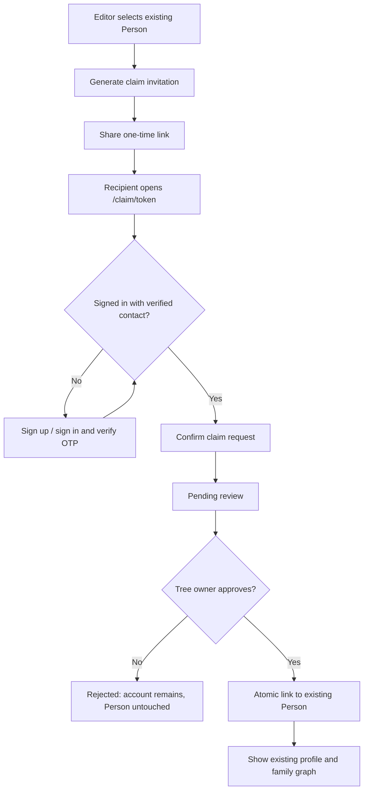

# ADR-002 — Person Invitation, Registration & Claim

**Status:** PROPOSED MVP ARCHITECTURE — design only, no database deployment  
**Date:** 2026-11-14  
**Target branch:** `dev/fullstack-mvp` (do not modify `main`)  
**Depends on:** `ADR-001-BACKEND-PORTABILITY.md` and `DATABASE-DESIGN.md`

## Product goal

A family-tree editor may create a Person for a real relative before that relative has a KnowYourFam account. The editor can later issue a person-specific invitation link. When the relative signs up (or signs in), verifies control of their email/phone, and their claim is approved, the account is **linked to the existing Person**. All previously authored profile facts and relationships remain intact.

**Important distinctions:**
- Person = a genealogical subject; application User = an actor who logs in.
- Authentication proves control of a login method, not necessarily real-world identity.
- Claim = assignment of account-to-Person representation in a specific Family Tree; it does not transfer copyright, personal-data ownership, custody of other Person profiles or entire tree editing rights.
- A shared URL cannot, by itself, grant person ownership or full tree access.

## Example: Rudi

1. Budi creates Person `P_RUDI` inside Tree `T_KELUARGA`. Relationships P_BUDI -> P_RUDI, P_SITI -> P_RUDI, P_RUDI <-> P_LINA and P_RUDI -> P_ARKA already exist.
2. Editor generates a one-time secure invitation for `P_RUDI`.
3. Rudi opens `https://<app-domain>/claim/<opaque-random-token>`. The UI may show only safe, minimal context, and only at the correct authorization step.
4. Rudi signs up using an email or phone OTP, or signs in if already registered. Authentication is handled through an interchangeable auth adapter.
5. User explicitly confirms "This is me" and sends a claim request.
6. Owner/editor with claim-approval permission reviews the request and approves it. An approver must not be the requester; initially only tree owner can approve.
7. In one transaction, the system links the verified application user to existing Person `P_RUDI`, establishes membership `contributor`, marks the claim approved and writes an audit event. The invitation token was already redeemed and reserved for this requester when the request was submitted.
8. Rudi sees his existing data and family relationships. **No INSERT into persons occurs during claim approval.**

## User flow



At request submission, atomically redeem the invitation and record `redeemed_by_user_id`; do not consume on preview/GET. For the MVP, approval is mandatory even when the invite arrived at a verified phone/email address. Future policies may enable owner-approved contact-bound auto-claim only after proper threat review.

## Database design (portable PostgreSQL core)

Reuse from the initial draft:
- `users`: application-owned UUID identity/profile, without password hash after the ADR-001 revision.
- `auth_identities`: maps `(provider, provider_subject)` to stable application `user_id`; does not reference `auth.users` in portable core.
- `family_trees`: contains Person and relationships.
- `persons`: existing genealogical profile, independent of account.
- `tree_members`: `(tree_id, user_id)`, `role`, optional `self_person_id` for the approved account-Person binding.

Add:

### `person_claim_invitations`

| Column | Type | Purpose |
|---|---|---|
| id | uuid PK | Internal invite ID |
| tree_id | uuid FK | Target tree |
| person_id | uuid | Target existing Person, same tree |
| token_hash | text unique | SHA-256 of high-entropy bearer token; raw token never stored |
| created_by_user_id | uuid FK | Inviting owner/editor |
| intended_contact_mac | text nullable | Optional server-side keyed HMAC of normalized verified email/phone; do not use unsalted SHA-256 for guessable contact data |
| contact_kind | text nullable | email / phone |
| expires_at | timestamptz | Link expiry (suggest 48h–7d configurable) |
| redeemed_at | timestamptz nullable | Set atomically on first accepted claim submission, not on GET preview or later approval |
| redeemed_by_user_id | uuid nullable FK | Account that first submitted the claim; blocks reuse while review is pending |
| revoked_at | timestamptz nullable | Revoked by owner |
| created_at | timestamptz | Audit timestamp |

Enforce composite foreign key `(tree_id, person_id) -> persons(tree_id, id)`. Index `(tree_id, person_id)` for active invites, token_hash unique, and expiration queries. Token generated with secure random bytes (e.g., 32 bytes); transmit through HTTPS; do not log/query-analytics its raw value.

### `person_claim_requests`

| Column | Type | Purpose |
|---|---|---|
| id | uuid PK | Request ID |
| invitation_id | uuid FK | Invitation used |
| tree_id | uuid | Target tree |
| person_id | uuid | Target existing Person |
| requester_user_id | uuid FK | Authenticated application user |
| status | text CHECK | pending, approved, rejected, cancelled |
| requested_at | timestamptz | Submission time |
| reviewed_by_user_id | uuid nullable FK | Approving tree owner |
| reviewed_at | timestamptz nullable | Decision time |
| review_note | text nullable | Minimal reviewer note |

Enforce consistent invitation `(id,tree_id,person_id)` reference with a suitable composite unique key; never trust tree/person values from client instead of the invitation row. One pending request per requester/invite; use an idempotency key or unique partial index to avoid duplicate submits. Several pending requests against the same target can be reviewed, but only one can win an approved binding.

### `person_claim_events` (minimal audit)

`id` uuid PK, `claim_request_id` FK nullable, `invitation_id` FK nullable, `actor_user_id` FK nullable, `event_type`, `created_at`, minimal JSONB metadata with no secrets. Record creation, view/action failures as appropriate, submission, approval, rejection, revocation and unlink. Do not store OTPs, invitation tokens, passwords, or whole private family records in audit metadata.

### Constraints on existing `tree_members`

Keep the existing unique membership `PRIMARY KEY (tree_id, user_id)`. Add:

```sql
CREATE UNIQUE INDEX ux_one_account_per_person_in_tree
ON tree_members (tree_id, self_person_id)
WHERE self_person_id IS NOT NULL;
```

This prevents two active memberships from claiming the same Person in the same tree. A user may claim distinct Persons across **different** trees because account identity is global while Person identity is tree-scoped. Each tree membership has at most one `self_person_id`. For future cross-tree same-real-person merging, do not hard-code a global `persons.user_id` FK.

If soft-delete memberships are added later, adjust uniqueness to only active rows and define a revocation process. The initial draft currently lacks membership soft-deletion fields.

## Data and ownership integrity

- Never create a new Person automatically when approving a claim.
- All profile fields and relationships retain the existing `person_id`; the newly approved `tree_members.self_person_id` only references it.
- The invited user receives `contributor` membership after approved claim and may edit permitted fields on their own Person or contribute new records according to `docs/PERMISSIONS-AND-CONTRIBUTIONS-MVP.md`. They do **not** gain global Editor rights or permission to rewrite all family links.
- New parent/partner/child links and corrections follow the definitive permission policy in `docs/PERMISSIONS-AND-CONTRIBUTIONS-MVP.md`: Contributor can add own/new unconfirmed relations without indirect-relative consent; high-impact or claimed-party changes use proposals.
- The family-tree owner retains the ability to correct relationship data but cannot use a person's login credentials.
- Claiming a profile is not equivalent to formal real-world identity verification; represent state as "linked to account", not "identity legally verified".
- For minors, deceased people or profiles with no clear real-world claimant, do not offer open self-claim; future guardian/legacy authority rules require separate design.
- A Person might be listed in several Family Trees; accounts may independently link to each tree's Person after separate approvals.
- The tree member's `self_person_id` is an authorization-relevant binding. The Person table must not store mutable login credentials.

## API/Use-case contracts (provider-neutral)

All endpoints below are **logical API contracts**, not necessarily public HTTP routes during Supabase MVP:

| Operation | Input | Result |
|---|---|---|
| `createPersonClaimInvite` | treeId, personId, optional intendedContact | expiresAt, invitation URL (shown once) |
| `previewPersonClaimInvite` | token | safe non-sensitive state only; no unapproved family graph |
| `requestPersonClaim` | token, authenticated user | pending request |
| `listPendingClaims` | treeId, authorized owner | review list |
| `approvePersonClaim` | claimRequestId, authenticated owner | approved membership/selfPersonId |
| `rejectPersonClaim` | claimRequestId, owner | rejected |
| `revokePersonClaimInvite` | invitationId, owner | revoked |
| `getMyLinkedPersons` | authenticated user | list of tree scoped selfPersonIds |
| `unlinkMyPerson` | membership / approved tree admin process | pending review/controlled revocation |

Applications expose an `IdentityLinkRepository` / `PersonClaimService` in their application layer. Angular components call that service; only an infrastructure adapter uses Supabase Auth/SDK. The future own backend replaces that adapter with HTTP calls using the same DTOs.

## Security / authorization

1. **Do not auto-claim from an invite link.** A copied/forwarded link is insufficient. Require authenticated, verified contact and explicit owner approval.
2. Issue short-lived, unpredictable, **single-use** bearer links. Store only token hashes. Make link redemption (claim submission) single-use; a GET preview or link-scanning bot must not redeem it. Support revoke and regenerate; old links no longer work. Rate-limit link previews, requests, approvals and invitation generation.
3. Optionally bind invite to verified recipient email/phone (compare normalized verified contact from trusted auth provider; client-provided metadata is not reliable). OTP proves contact control, not identity.
4. Pre-auth link screens should not leak full name, parent names, relatives, gender, or other data. After login expose only minimal claim context necessary, never the entire tree until authorized.
5. Protect the invite and claim tables behind a privileged operation boundary (backend service / audited server function or narrowly scoped RPC). Do not let ordinary authenticated clients issue unrestricted UPDATE or SELECT against them.
6. Require **tree owner** authorization for issuance and approval in MVP; deny self-approval. Re-check owner permissions inside the approval transaction.
7. During approval, lock the invitation, request, relevant membership and target Person/claim slot; check invitation was previously redeemed by the exact requester and remains valid for that pending request, claimant identity, tree consistency, Person unclaimed, valid status, and membership invariants. Update in **one database transaction**; rejection leaves other profiles untouched.
8. Handle simultaneous claim approvals as a conflict: only one account wins the unique `(tree_id,self_person_id)` constraint, with a clear error to the other requester.
9. Set RLS and minimal GRANTs for all exposed tables. Never send Supabase secret/service-role keys to the browser. Keep privileged functions in a private schema or trusted server, deny unintended public EXECUTE, and audit invoker/definer decisions.
10. No raw invite tokens/OTP in database logs, analytics, referrals, error reports or application telemetry. Recommend `Referrer-Policy: no-referrer`, minimal third-party scripts on claim route, and stripping token from browser URL after secure intake.
11. The claimed person might be under age or already linked; deny creation of new invite without a controlled exception review. Identity conflicts/takeovers require owner-assisted revocation; do not swap the `self_person_id` on a failed request.
12. Unlink/revoke needs a documented revocation policy; user account deletion must not delete the genealogical Person.

## Implementation options

**MVP on Supabase:** Supabase Auth provides signup/signin and verified email/phone flows. An authenticated server-side Edge Function or narrowly scoped PostgreSQL function handles issuing, consuming and approving custom claim invitations transactionally. **These are application claim invites, not interchangeable with Supabase's native email Auth invitation link.** RLS and grants control tree read/edit access. Credentials remain in the provider's auth storage, connected to application users via the ADR-001 `auth_identities` mapping.

**Future own backend:** move the claim use-cases into Spring Boot/Node services with equivalent transactions and authorization; keep `person_claim_invitations`, `person_claim_requests`, `tree_members.self_person_id`, and all genealogical relationships unchanged. Replace the login identity adapter, invite delivery/verification integration, and APIs. Passwords cannot be assumed exportable from Supabase Auth.

## UX states and pages

1. Person detail: `Undang pemilik profil`, `Link sudah dibuat`, `Klaim menunggu persetujuan`, `Akun terhubung`, or `Klaim ditolak` based on claim state.
2. Claim route `/claim/:token`: landing + safe error cases (expired, revoked, already used, person already claimed). No public graph by default.
3. Auth page: register/login with verified email or phone; preserve the claim context through the redirect without exposing it to unrelated providers.
4. `Konfirmasi ini profil saya`: explicitly consent to account binding and family access.
5. `Menunggu persetujuan`: pending status, can cancel request.
6. Owner's `Permintaan klaim` review list with authenticated requester identifier, target person, submitted timestamp and Approve/Reject.
7. On approval, login/home defaults to the user's linked Person, with existing parents, siblings, partner, children and expandable family tree.

## Suggested vertical slices

**Slice A — data model and policy:** portable identity mapping, claim tables, constraints, RLS plan, schema tests. Do not connect to a live Supabase project without the user's authorized choice.

**Slice B — link issue and claim submission:** server-generated short-lived link, login/verification, pending request and viewer-safe screens.

**Slice C — owner approval and binding:** atomic approval, tree membership, duplicate/race tests, minimal audit.

**Slice D — linked-person home:** onboarding directly to existing Person, family graph, role-restricted editing.

**Slice E — hardening:** rate limits, expiry/revocation, consent/privacy, unauthorized access tests, usability and mobile tests.

## Required acceptance tests

- Invited Person exists before registration; after approved claim there is **exactly one** Person row and identical relationship rows.
- Valid login with no invite cannot claim somebody else's Person.
- Forwarded link cannot auto-claim; a requester remains pending until approved.
- Expired/revoked/reused token fails on new claim submissions; browser preview never consumes the token; a replacement token does not reactivate the previous one.
- Two users attempting the same Person cannot both win.
- Same account can belong to two family trees and link to different Person rows.
- A user who is not a tree member cannot query private person/relative rows.
- Viewer cannot change another Person or family relationships.
- Claim approval failure is atomic and idempotent on retries.
- Removing a user's account/claim binding does not delete Person or relationships.
- Core PostgreSQL schema works without Supabase Auth schema, and the auth-provider adapter is replaceable.

## Explicitly out of scope

No auto identity matching by name or phone, no account-to-person auto linkage from signup alone, no cross-tree profile merging, no guardian claims, no independent evidence-verification governance, no public person directory, and no claim via a permanent unprotected Person ID or QR code. A QR code can be added later as a presentation form of the same short-lived secure invitation.

**Implementation status:** architecture/documentation only. The initial `database/migration/V1__family_tree_core.sql` remains a draft and does not yet include the `auth_identities` or claim tables. Do not treat this document as a completed, deployed feature.
