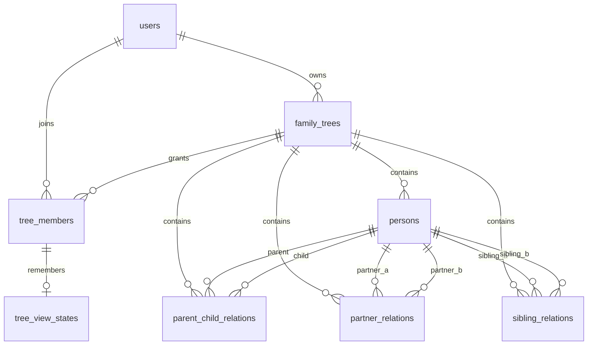

# KnowYourFam — MVP Database Design

**Status:** Draft v1, superseded for authentication/portability by `docs/ADR-001-BACKEND-PORTABILITY.md` · **Database:** standard PostgreSQL 14+ · **Current frontend:** single-file `index.html` with `localStorage`.

**DO NOT DEPLOY INITIAL V1 SQL UNCHANGED:** `database/migration/V1__family_tree_core.sql` is a reference draft, not the final Supabase migration. Before deployment, separate the application-owned `users` identity from auth credentials, introduce `auth_identities` mapping, and keep Supabase `auth.users` references/RLS out of the portable core schema. The approved architecture is in ADR-001.

## Goal

Support a user creating a family tree, adding unlimited ancestry/descendant generations, parents, children, partners, and siblings, browsing Focus Person and Full Overview, opening/closing one family/origin branch at a time, and deleting a relationship without deleting the person's profile. Keep the MVP small; do not implement governance, evidence review, duplicate resolution across trees, or complex permissions yet.

## Data model



The original draft contains eight tables in `V1__family_tree_core.sql`; the actual deployed core will also include the `auth_identities` mapping (see ADR-001):

| Table | Purpose |
|---|---|
| `users` | **Future portable core:** application user profile and stable UUID; no password hash in domain table (V1 SQL currently draft) |
| `family_trees` | Tree workspace, owned by a user |
| `tree_members` | Owner/editor/viewer membership; `self_person_id` belongs here |
| `persons` | Person profile; exactly one active profile per represented individual **within that tree** is a product goal |
| `parent_child_relations` | Directional parent → child and parent type |
| `partner_relations` | Undirected, explicitly stated partnership; never inferred from a child |
| `sibling_relations` | Directly recorded sibling relation only when parent data is unknown/incomplete |
| `tree_view_states` | Per-user Focus Person / Full Overview and optional opened branches |

**Authentication portability decision (ADR-001):** add `auth_identities` (provider + provider subject mapped to stable app user), do not FK core tables to Supabase `auth.users`; Supabase Auth and RLS belong to provider-specific migrations. A future own backend uses the same domain user IDs and relationship tables with a different auth adapter. This is a required schema design change **before the first live migration**, not a claim that the current V1 SQL already implements it.

**Important:** `FamilyUnit` is a *read-model / layout grouping*, not an extra table or alternative relationship source in v1. The UI may group two explicitly linked partners with their shared children, or represent a single-parent unit. Do not invent a partner relation when two parents share a child. Add persistent `family_units` later only if clear use cases require one.

## Example: Rudi + Lina, with their separate origin families

- Budi → Rudi; Siti → Rudi; Budi → Andi; Siti → Andi.
- Joko → Lina; Ratih → Lina.
- Hasan → Maya; Rina → Maya.
- `partner_relations` contains (Rudi, Lina) and (Andi, Maya), plus the older couples **only if those partnerships are known**.
- The two families do **not** become one ancestor group through Rudi–Lina's partnership.
- If Maya's father Hasan's parents are added, they are simply more parent-child edges; no generation integer is updated.

The position of each card, vertical tier, cross-family branch, generation number and canvas pan/zoom are **derived UI information**, not family facts to store on `persons`.

## Relationship rules

1. `parent_child_relations`: one directed pair; `parent_person_id != child_person_id`. Validate parent-cycle prevention via a recursive CTE in a transaction. Biological/adoptive/step/guardian are different relationship types; do not enforce an unconditional “two parents maximum” limit.
2. `partner_relations`: explicitly created, stored as ordered UUID pair (`person_a_id < person_b_id`) to avoid (A,B)/(B,A) duplicates. Multiple partners over time are possible. Historical remarriage/events can be modeled separately later.
3. `sibling_relations`: only store an explicit sibling assertion. If two persons share at least one parent, siblings are derived through joins; merge explicit + derived results by person ID to avoid duplicates. An explicitly added sibling does not create unknown parents automatically.
4. All relation endpoints must exist in the **same** `family_trees.id`. This is enforced via composite foreign keys `(tree_id, person_id)` to `persons(tree_id,id)`.
5. “Hapus hubungan” sets `deleted_at` (and optionally `deleted_by`) on the relation; no person is deleted. “Collapse branch” modifies UI state only.
6. Soft-deleted persons and relations are excluded from active graph queries. Access control on every tree operation must check `tree_members`.
7. `self_person_id` belongs to `(tree_id,user_id)` membership; it is not a global `persons.is_self` field.

## Focus Person vs Expand/Collapse

Default Focus Rudi returns Rudi, Rudi's parents and siblings, Rudi's partners and children, and each partner's parents and siblings. **It does not recursively include grandparents, siblings' partners, nieces/nephews or cousins.**

The client represents each expanded branch as a `family:<person_id>` or `origin:<person_id>` key:

- `family:<id>` reveals *partners and children* of that person.
- `origin:<id>` reveals *parents and siblings* of that person.
- Initially reveal no more than 12 newly requested people per expansion; “show more” can page the rest.
- Expanding a partner does not automatically expand that partner's whole ancestral graph.
- Changing focus resets open branches (optional back-navigation keeps a separate view history).
- Family Overview may use aggregated clusters when the tree becomes large; never assume all thousands of people must be rendered at once.

A focus or branch endpoint should return both `persons` and `relations`, with opaque stable UUIDs:

```json
{
  "focusPersonId": "uuid",
  "persons": [{"id":"uuid","fullName":"Rudi"}],
  "parentChildRelations": [],
  "partnerRelations": [],
  "siblingRelations": [],
  "collapsedBranches": [{"key":"origin:uuid","hiddenCount":8}],
  "hasMore": false
}
```

A count of hidden relatives should be calculated by the query layer (not stored on the Person). Keep list/search endpoints separate from layout coordinates.

## Suggested MVP endpoints

| Verb/path | Responsibility |
|---|---|
| `POST /api/trees` | Create tree and owner membership in one transaction |
| `GET /api/trees/{treeId}` | Read tree metadata and permissions |
| `POST /api/trees/{treeId}/persons` | Add a person |
| `PATCH /api/trees/{treeId}/persons/{personId}` | Update profile |
| `GET /api/trees/{treeId}/persons?search=...` | Find a person, including collapsed branches |
| `POST /api/trees/{treeId}/relationships/parent-child` | Insert parent-child edge |
| `POST /api/trees/{treeId}/relationships/partners` | Insert partnership |
| `POST /api/trees/{treeId}/relationships/siblings` | Record explicit sibling edge |
| `DELETE /api/trees/{treeId}/relationships/{type}/{relationId}` | Soft-delete an edge |
| `GET /api/trees/{treeId}/graph?focusPersonId=...` | Focused subgraph and hidden counts |
| `GET /api/trees/{treeId}/branches?personId=...&kind=origin&limit=12` | One branch expansion page |
| `PUT /api/trees/{treeId}/view-state` | Save optional per-user view preferences |

For MVP, single-owner editing is sufficient; `tree_members` prepares for future invitations. Authorization and collision checks run in the backend, not only in the frontend.

## Concurrent edits, integrity and performance

- To insert a parent edge, start a transaction, lock the target `family_trees` row with `FOR UPDATE`, then check via `WITH RECURSIVE` that the candidate parent is not reachable from the candidate child. This avoids parallel transactions introducing a cycle.
- Keep partial unique indexes on active relationships. Soft-deleting a relation allows a later new active record for the same pair.
- Query and index both directions of each relation, and index persons by tree and name.
- Perform pagination for large result sets; cap returned graph nodes, not actual stored family size.
- Store profile photos as object-storage URLs (`photo_url`), **not** browser data URLs or base64 in PostgreSQL.
- Keep `created_at`, `updated_at`, `created_by`, and soft-delete metadata. A detailed audit-log table can be added when collaboration is introduced.
- A full connected-component graph can be very large or cyclic through partnerships. Traversal should track visited person IDs and respect depth/page caps.

## Existing `index.html` → database mapping

| Local prototype | Database |
|---|---|
| `treeName` | `family_trees.name` |
| `people[].id` | `persons.id` |
| `people[].name` | `persons.full_name` |
| `people[].photo` | `persons.photo_url` (upload media to object storage) |
| `people[].nickname/birthPlace/residence/occupation/notes` | Corresponding `persons` columns |
| `people[].self` | `tree_members.self_person_id` |
| `parent: [[a,b]]` | `parent_child_relations` rows |
| `partner: [[a,b]]` | `partner_relations` rows (ordered UUID pairs) |
| `sibling: [[a,b]]` | `sibling_relations` explicit rows |
| `focusRoot`, `treeMode`, `expandedBranches` | `tree_view_states` or temporary client-only state |
| Calculated generation, node `x/y`, zoom and pan | **Not stored** as family truth |

**Migration note:** the mock `p1`,`p2` identifiers are *not UUIDs*; the import API should create UUIDs and map old IDs to new ones before inserting edges in a transaction.

## Deliberately not included in v1

Cross-tree canonical person merging, guardianship mandates, claims/evidence verification, full consent/privacy workflows, family governance, revision conflicts, historical relationship events and biographies. These should become later bounded-context additions, not prerequisites for a usable family tree.